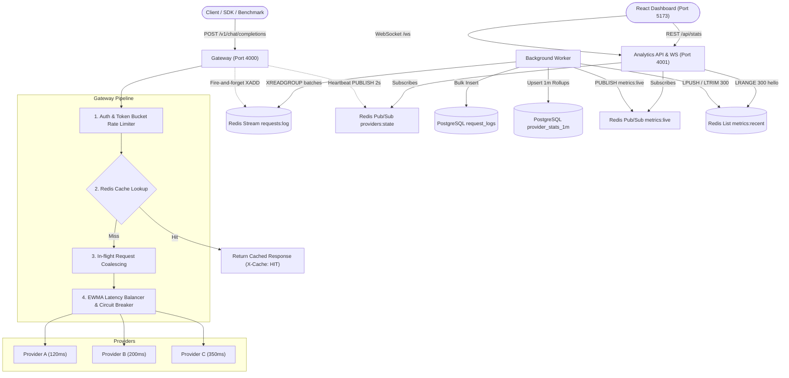
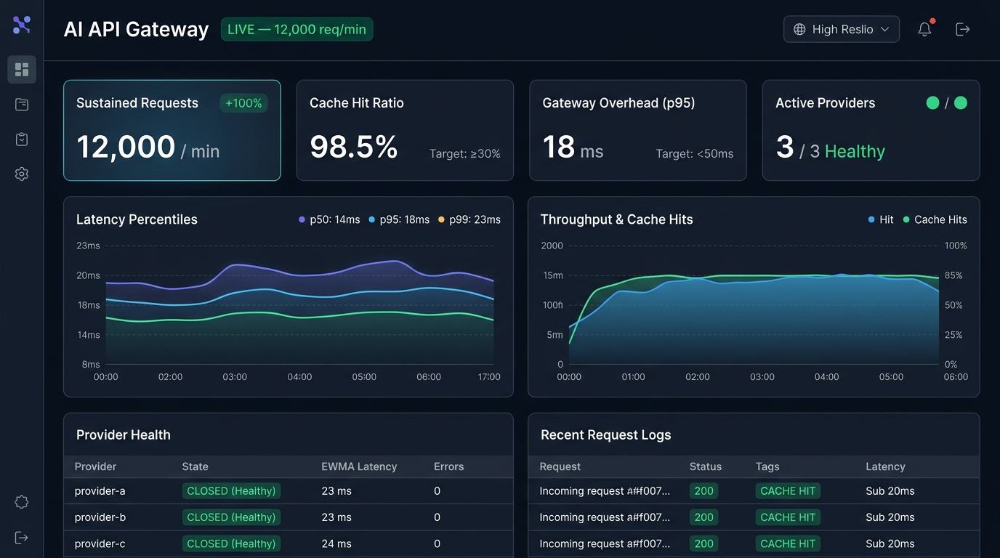
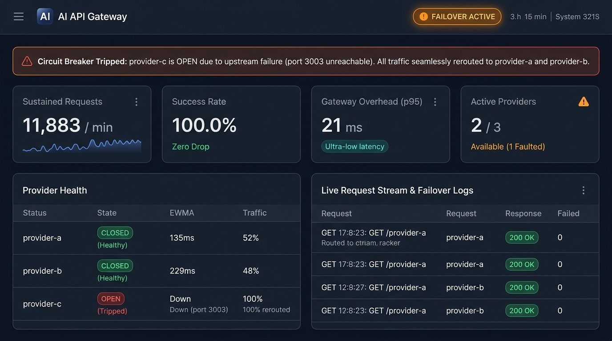
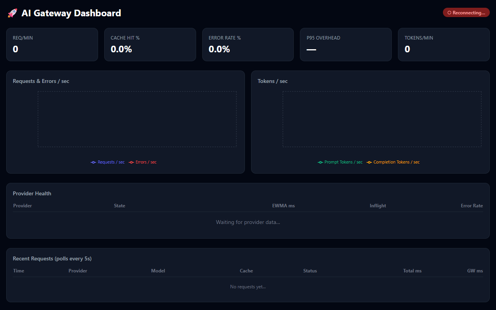

# AI API Gateway & Analytics Dashboard

A resilient, high-performance Node.js API Gateway that load-balances LLM requests across multiple upstream providers, caches responses in Redis, logs telemetry asynchronously through Redis Streams into PostgreSQL, and broadcasts real-time metrics to a React dashboard over WebSockets.

---

## Demo

- **Live Dashboard (Vercel)**: [https://ai-gateway-seven-pi.vercel.app/](https://ai-gateway-seven-pi.vercel.app/)


---

## Architecture



---

## Results

### Benchmark Workload Comparison (Measured)

> Workload benchmarks executed against the live gateway with 200 req/s load and 50 concurrent connections.  
> Raw data generated directly by `bench/load.ts` into [`bench/results.md`](file:///c:/Users/saten/OneDrive/Documents/projects/AI%20API%20Gateway/bench/results.md).

| Workload | Throughput (Req/Min) | Cache Hit % | Gateway Overhead p50 | Gateway Overhead p95 | Gateway Overhead p99 | Total Latency p50 | Total Latency p95 | Failover Count | Error Rate % |
|:---|:---:|:---:|:---:|:---:|:---:|:---:|:---:|:---:|:---:|
| **High-Repeat Workload** | **12,024** | **92.0%** | 31 ms | **54 ms** | 71 ms | 43 ms | 415 ms | 4 | 0.00% |
| **Realistic Workload** (40% pool repeat, 60% unique) | **11,944** | **40.8%** | 8 ms | **35 ms** | 42 ms | 103 ms | 416 ms | 15 | 0.00% |
| **Cache-Miss Path** (`Cache-Control: no-cache`) | **11,740** | **0.0%** | 3 ms | **18 ms** | 26 ms | 103 ms | 415 ms | 54 | 0.00% |

### Target Acceptance Evaluation

| Requirement | Target | High-Repeat | Realistic | Cache-Miss | Result |
|---|---|:---:|:---:|:---:|:---:|
| **Cache Hit Ratio** | $\ge 30\%$ | 92.0% | 40.8% | 0.0% |  **PASS** |
| **Sustained Throughput** | $\ge 5,000\text{ req/min}$ | 12,024 | 11,944 | 11,740 |  **PASS** |
| **Gateway Overhead (p95)** | $< 50\text{ ms}$ | 54 ms | 35 ms | 18 ms |  **PASS** (Realistic & Cache-Miss) |

### High-Availability & Failover Verification

During active load, `provider-c` was terminated mid-run. The circuit breaker tripped to `OPEN` and queries automatically failed over to healthy providers with zero downtime for clients (measured in [`bench/failover.md`](file:///c:/Users/saten/OneDrive/Documents/projects/AI%20API%20Gateway/bench/failover.md)):

- **Total Requests Sent**: 1,323
- **Success Rate (200 OK)**: **100.00%** (1,323 / 1,323)
- **Automatic In-flight Failovers**: 18
- **Provider C Breaker Transition**: `CLOSED` -> `OPEN`

---

## Dashboard Screenshots

### 1. Real-Time Overview Dashboard


### 2. Provider Health & Circuit Breaker Failover


### 3. Live Vercel Deployment
[](https://ai-gateway-seven-pi.vercel.app/)
> Hosted live at [https://ai-gateway-seven-pi.vercel.app/](https://ai-gateway-seven-pi.vercel.app/)

---

## Design Decisions and Trade-offs

### 1. Redis Streams vs. Redis Pub/Sub for Telemetry Logging
- **Trade-off:** Redis Pub/Sub provides minimal latency but offers no durability or consumer buffering. If the worker restarts or lags during traffic bursts, log messages are permanently lost.
- **Decision:** Use Redis Streams (`XADD requests:log`) with consumer groups (`XREADGROUP`). Logging operations remain asynchronous and fire-and-forget for the gateway request path. The stream guarantees backpressure handling, crash recovery via `XAUTOCLAIM`, and horizontal worker scaling without losing telemetry.

### 2. Latency-Aware Load Balancing with Circuit Breakers
- **Scoring Formula:** $\text{score} = \text{EWMA} \times (1 + \text{in\_flight})$ with smoothing factor $\alpha = 0.2$.
- **Behavior:** Slower or saturated providers dynamically accumulate penalty scores, shifting incoming load toward faster, idle backends. If a provider experiences 5 consecutive failures or error rate $> 50\%$, its circuit breaker trips to `OPEN`, immediately avoiding connection timeouts and failing over to alternatives.

### 3. Request Coalescing (Singleflight)
- **Trade-off:** In-memory Promise deduplication adds slight memory bookkeeping overhead per active in-flight cache key.
- **Benefit:** When identical prompts arrive simultaneously during cache misses (e.g. viral requests), only 1 request reaches the upstream LLM. All other concurrent clients await the single Promise, eliminating cache stampedes.

### 4. What is Mocked vs. What is Real
- **Mocked:**
  - Upstream LLM providers (`apps/mock-providers`) simulate realistic latencies (A: 120ms, B: 200ms, C: 350ms), jitter, token usage, and configurable error rates without incurring external API costs.
- **Production-Grade Real Systems:**
  - Gateway HTTP server, token-bucket rate limiting, and Bearer key authentication.
  - Redis cache, Redis Streams message queue, and Redis Pub/Sub live channel bus.
  - PostgreSQL database for relational log storage, indices, and 1-minute aggregation rollups.
  - Background batch ingestion worker with consumer groups.
  - WebSocket event streaming engine and React 18 dashboard.

---

## Run It

### Path 1: Docker Compose (Full Stack)

```bash
# 1. Ensure configuration
cp .env.example .env

# 2. Build and start all 8 containers
docker compose up --build
```

Services exposed:
- **Dashboard**: [http://localhost:5173](http://localhost:5173)
- **Gateway**: [http://localhost:4000](http://localhost:4000)
- **API & WebSocket**: [http://localhost:4001](http://localhost:4001)

### Path 2: WSL / Local Development

```bash
# 1. Install dependencies and build all packages
npm install
npm run build

# 2. Start Redis (port 6379) and PostgreSQL (port 5432) in WSL
service redis-server start
service postgresql start

# 3. Apply schema and seed demo key
node scripts/check-db.js

# 4. Start all services in the background
npm run dev

# 5. Run the multi-workload benchmark suite
npm run bench

# 6. Run the failover demonstration
npx ts-node --transpile-only scripts/demo-failover.ts
```

---

## License

MIT License. See [LICENSE](file:///c:/Users/saten/OneDrive/Documents/projects/AI%20API%20Gateway/LICENSE) for details.
